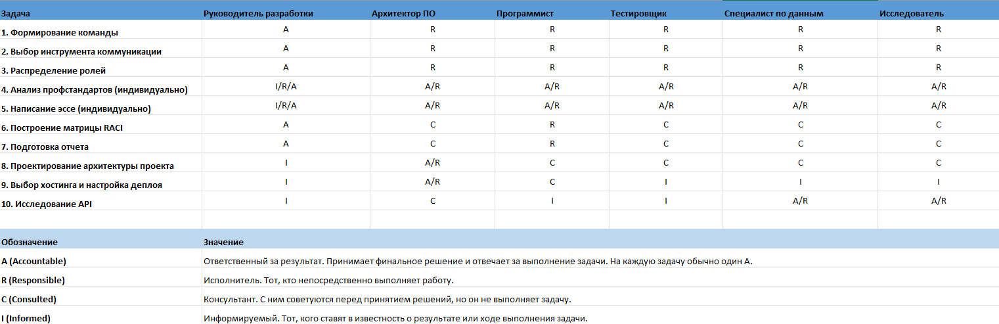

# Отчет по практической работе №1

**Дисциплина:** Введение в профессиональную деятельность
**Выполнили:** студенты группы 6414
**Преподаватель:** Крошилина С.В.
**Дата:** 23.09.2026

## 1. Формирование команды

**Название команды:** CS-133

**Состав команды:**
1.  **Программист:** Волков Алексей Владимирович
2.  **Архитектор программного обеспечения:** Антонов Максим Андреевич
3.  **Специалист по тестированию:** Яковлев Виталий Юрьевич
4.  **Руководитель разработки:** Беженар Даниил Алексеевич
5.  **Специалист по данным:** Агафонова Екатерина Александровна
6.  **Исследователь:** Арекаев Даниил Николаевич

## 2. Описание выбранного способа коммуникации и правил взаимодействия

**Инструмент коммуникации:** Telegram (создан общий групповой чат команды).

**Правила общения и ведения учебного проекта:**
1.1) Без флуда/спама в рабочих ветках, все обсуждения проводить в отдельной ветке "Флуд".
1.2) Каждая объемная задача должна сопровождаться созданием отдельной ветки обсуждения.
1.3) Итоги крупных обсуждений должны быть зафиксированы одним сообщением.

2) Ход работы происходит исходя из учебных дедлайнов, соответственно:
2.1) Крупные задачи разбиваются на более мелкие, срок выполнения которых не больше чем: количество подзадач // на время выполнения общей задачи.
2.2) Лицо, ответственное за задачу, должно отчитаться о сделанной задаче или о возможном срыве дедлайна, с запросом о помощи.
2.3) Общая задача должна быть сделана не позже, чем за 24 часа до ее сдачи в учебном процессе, чтобы было время на доработку и оценку ответственным лицом.

3.1) Спорные решения принимаются по итогу обсуждения/голосования.
3.2) Руководитель разработки и Архитектор ПО имеют право вето, по закрытию обсуждений о ходе разработки и реализации программы.
3.3) Специалист по тестированию может заморозить релиз и обратиться к Руководителю или Архитектору при обнаружении ошибок в программе, до отправки ее на прод.

## 3. Распределение ролей

### Краткий состав команды

| Роль                         | Участник                     | Telegram username  |Git hub username |
| :--------------------------- | :--------------------------- | :----------------- |:--------------- |
| Руководитель разработки      | Беженар Даниил Алексеевич    | @Danon_yolo        |                 |
| Архитектор ПО                | Антонов Максим Андреевич     | @XERJI_OFFICIAL    |                 |
| Программист                  | Волков Алексей Владимирович  | @Volkov547         |                 |
| Специалист по тестированию   | Яковлев Виталий Юрьевич      | @vvitusss          |                 |
| Специалист по данным         | Агафонова Екатерина Алекс.   | @kitkatonn         |                 |
| Исследователь                | Арекаев Даниил Николаевич    | @Danillsfq         |                 |

### Обоснование выбора ролей

*   **Беженар Даниил Алексеевич (Руководитель разработки):** Личное желание научиться распределять ресурсы команды, путем структуризации задач. Сформировать навыки управления работы команды и распределения задач между специалистами разного спектра для успешной реализации проекта в срок.
*   **Антонов Максим Андреевич (Архитектор ПО):** Мой выбор роли Архитектора программного обеспечения обусловлен тем, что в отличие от «узкого» программиста, я могу видеть проект целиком. Это критически важно для архитектора: нужно не просто писать код, а выбрать оптимальный стек, спроектировать структуру базы данных, продумать интеграцию с API и обеспечить безопасность. Навыки работы с клиент-серверными приложениями и алгоритмами позволяют мне заложить надежный фундамент, на котором команда сможет реализовать гибридный сервис без хаоса и лишних переделок.
*   **Волков Алексей Владимирович (Программист):** Интересуюсь языками программирования и созданием чего-либо нового.
*   **Яковлев Виталий Юрьевич (Специалист по тестированию):** Интерес к анализу и внимательности к деталям. Мне интересно находить ошибки и проверять, как проект ведёт себя в разных условиях.
*   **Агафонова Екатерина Александровна (Специалист по данным):** Интерес к анализу и работе с данными.
*   **Арекаев Даниил Николаевич (Исследователь):** Хочу научиться исследовать предметную область учебного проекта, выявлять потребности пользователей и участников, осваивать подготовку понятной документации для команды.

### Матрица RACI
*(Скриншот матрицы RACI, составленной командой)*

## 4-5. Анализ профессиональных стандартов и трудовые функции

### Руководитель разработки
*   **Профессиональный стандарт:** Руководство разработкой компьютерного программного обеспечения (06.017).
*   **Основная цель профессиональной деятельности:** Осуществление деятельности по организации и управлению процессами разработки, отладки, проверки работоспособности и модификации компьютерного программного обеспечения, и управлению ресурсами.
*   **Трудовые функции:**
    *   Управление командой, распределяя задачи специалистам и регулируя рабочие споры.
    *   Управление ходом разработки, путем установки сроков выполнения задач и координации специалистов.
*   **Эссе:** Моя роль «Руководитель разработки» — это связующее звено всей команды. Моя цель — структурировать задачи, распределять их по специалистам и обозначить понятные сроки их выполнения, а также координация процесса, решение разногласий. Ожидаемый результат — это отлаженный механизм взаимодействия между специалистами разного профиля внутри команды.

### Архитектор программного обеспечения
*   **Профессиональный стандарт:** Архитектор программного обеспечения (06.003).
*   **Трудовые функции:**
    *   Проектирование программного обеспечения.
    *   Разработка архитектуры программных средств.
    *   Определение технологий и инструментов разработки.
    *   Оценка качества и эффективности архитектурных решений.
*   **Эссе:** В проекте «Помощник по управлению временем» я выступаю как Архитектор ПО. Я спроектирую структуру гибридного сервиса (сайт и Telegram-бот), выберу технологии и продумаю интеграцию с API РГРТУ. Ожидаемый результат — техническая документация, которая позволит команде избежать хаоса при разработке и создать удобный инструмент для студентов.

### Программист
*   **Профессиональный стандарт:** Программист (06.001).
*   **Основная цель:** Разработка, отладка, модификация компьютерного программного обеспечения (ПО).
*   **Трудовые функции:**
    *   Разработка и отладка программного кода.
    *   Проверка работоспособности и рефакторинг кода программного обеспечения.
    *   Разработка требований и проектирование программного обеспечения.
    *   Интеграция программных модулей и компонентов и проверка работоспособности выпусков программного продукта.
*   **Эссе:** Моя роль заключается в создании и написании кода, который используется при работе с данными. Мой вклад проявляется в автоматизации процесса, который мы используем. Ожидаемый результат — создание кода, при помощи языков программирования, успешная работа кода без выведения ошибок.

### Специалист по тестированию
*   **Профессиональный стандарт:** Специалист по тестированию в области информационных технологий (06.004).
*   **Основная цель:** Оценка качества разрабатываемого программного обеспечения путем проверки соответствия программного продукта заявленным требованиям.
*   **Трудовые функции:**
    *   Планирование и организация процесса тестирования.
    *   Разработка тестовых сценариев на основе требований.
    *   Выполнение ручного тестирования функционала.
    *   Фиксация и документирование найденных дефектов.
    *   Проверка исправлений после доработок разработчиками.
*   **Эссе:** Моя роль — тестирование готового продукта. Я проверю работу проекта и найду ошибки до того, как их увидит будущий пользователь. Ожидаемый результат — корректно работающий сервис без критических дефектов.

### Специалист по данным
*   **Профессиональный стандарт:** Специалист по управлению данными и информационными объектами (06.056).
*   **Основная цель:** Повышение качества данных информации объектов (ИО) и рост эффективности их использования в профессиональной деятельности организаций.
*   **Трудовые функции:**
    *   Обработка данных и ИО.
    *   Управление жизненным циклом данных и ИО.
    *   Формирование и внедрение методики работы с данными и ИО.
    *   Управление качеством данных и ИО.
*   **Эссе:** Моя роль состоит в обеспечении правил работы с данными и контроля их качества. Мой вклад проявляется в разработке регламентов управления данными, проверки качества данных, прослеживаемости их происхождения. Ожидаемый результат — управление данными единой среды при помощи актуальных методов, понятные и надежные данные и лёгкая доступность к ним.

### Исследователь
*   **Профессиональный стандарт:** Системный аналитик (06.022).
*   **Основная цель:** Изучать предметную область и потребности учебного проекта, превращать их в понятные требования для команды.
*   **Трудовые функции:**
    *   Исследование предметной области, сбор и анализ требований учебного проекта.
    *   Структурирование задач, подготовка документации.
    *   Согласование требований между учебным проектом и командой разработки.
    *   Разрешение неоднозначностей и рабочих разногласий.
*   **Эссе:** Моя роль — это исследование в области системного анализа. Я являюсь связующим звеном между учебным проектом, пользователями и командой разработки. Моя задача — исследовать предметную область проекта, выявлять задачи и структурировать их в понятные требования. Ожидаемый результат — понятное описание требований, на которое может опираться команда при выполнении учебного проекта.

## 7. Оформление результатов

**Вывод:**
В ходе выполнения самостоятельной работы №1 команда «CS-133» была сформирована, выбраны инструменты коммуникации и установлены правила взаимодействия. Между участниками распределены профессиональные роли с обоснованием выбора, проанализированы соответствующие профессиональные стандарты и выделены трудовые функции. Составлена матрица RACI, которая позволила чётко разграничить зоны ответственности и исключить дублирование задач.

Работа показала, что эффективность команды напрямую зависит от понимания каждым участником своей роли и ответственности. Полученные навыки будут использованы при дальнейшей работе над проектом.

## Контрольные вопросы:
1.  **Что такое профессиональная роль?** — Совокупность трудовых функций и зон ответственности, закреплённых за специалистом в команде.
2.  **Что включает профессиональный стандарт?** — Перечень трудовых действий, необходимых умений и знаний, требуемых для выполнения конкретной работы.
3.  **Что такое матрица RACI?** — Инструмент распределения ролей: R (Исполнитель), A (Ответственный), C (Консультант), I (Информируемый).
4.  **Чем отличаются R и A?** — R выполняет работу, а A несёт ответственность за её результат и принимает финальное решение.
5.  **Зачем нужно распределение ответственности?** — Чтобы избежать дублирования задач, чётко понимать, кто за что отвечает, и вовремя выявлять ошибки.
