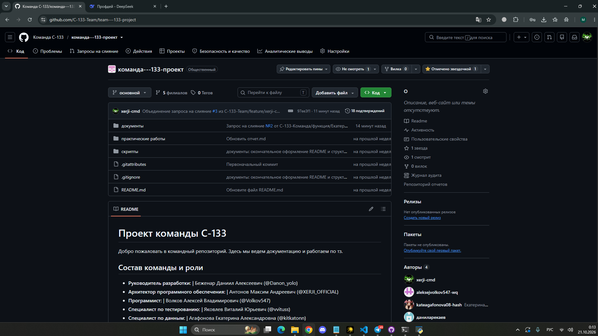
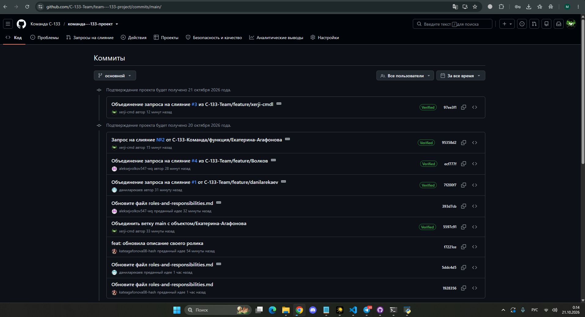
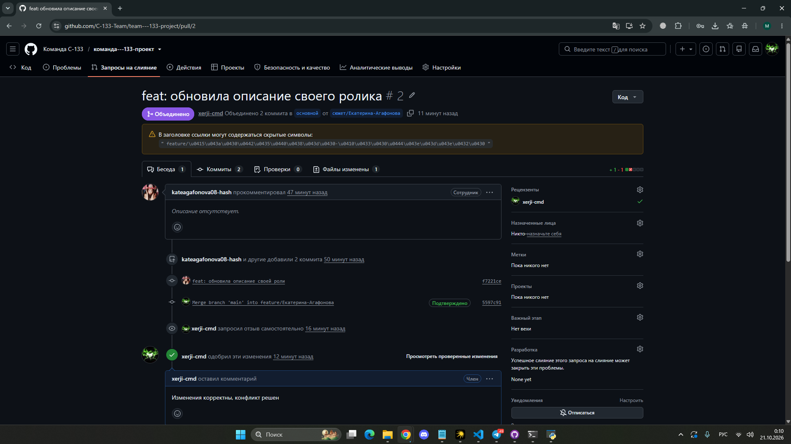
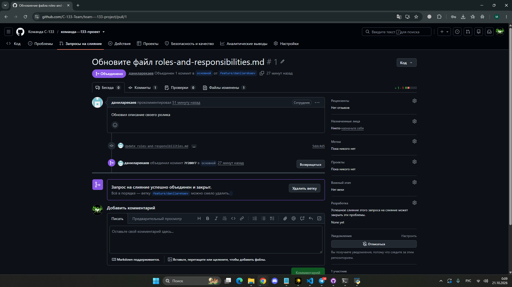
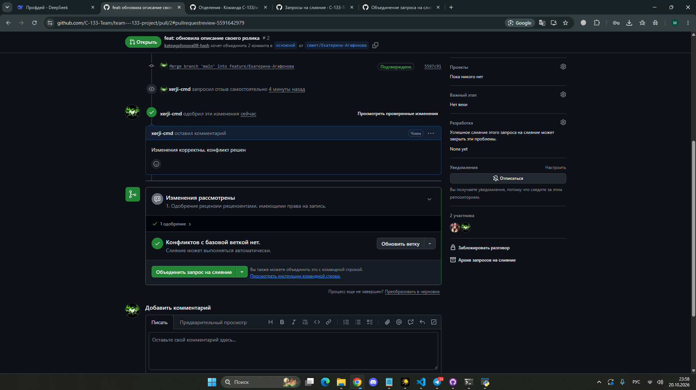
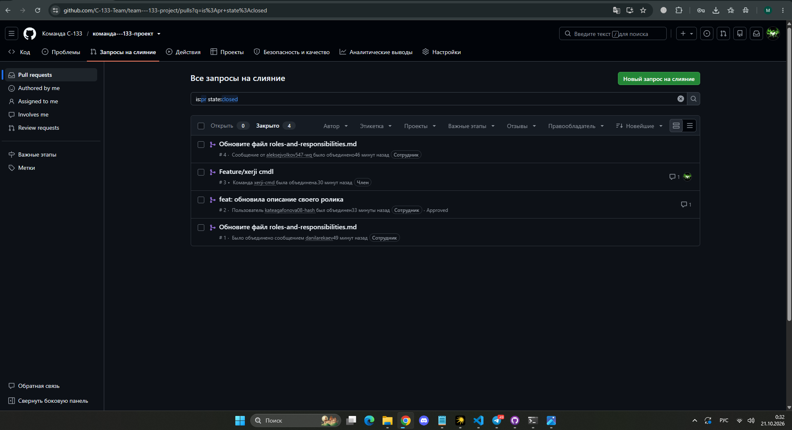

# Отчет по самостоятельной работе №2

**Тема:** Организация работы с репозиторием проекта и распределение ответственности в Git.

**Дисциплина:** Введение в профессиональную деятельность
**Команда:** CS-133

## 1. Ссылка на командный репозиторий
Репозиторий проекта успешно создан и доступен по ссылке: 
[https://github.com/C-133-Team/team---133-project](https://github.com/C-133-Team/team---133-project)

## 2. Подтверждение регистрации участников (логины)
Все участники команды зарегистрированы на GitHub и добавлены в организацию `C-133-Team`:
*   `xerji-cmd` (Антонов М.)
*   `kateagafonova08-hash` (Агафонова Е.)
*   `aleksiejvolkov547-wq` (Волков А.)
*   `danilarekaev` (Арекаев Д.)
*   *(Остальные участники по мере принятия приглашений)*

## 3. Структура репозитория
В соответствии с методическими указаниями, в репозитории создана строгая структура папок: `docs` (документация), `practical-works` (отчеты по работам с 01 по 08), `scripts` (вспомогательные скрипты). Каждая практическая работа имеет свою папку с файлом `report.md` и папками `assets` или `src`. Также в корне добавлен файл `.gitignore`.

## 4. Распределение обязанностей по работе с репозиторием
На основе матрицы RACI, разработанной в СР1, обязанности в Git распределены следующим образом:
*   **Руководитель разработки (Беженар Д.):** Создание репозитория, настройка прав доступа, проверка Pull Request'ов (Ревью), слияние веток в основную ветку (Merge), разрешение конфликтов слияния.
*   **Архитектор ПО (Антонов М.):** Проверка изменений на соответствие архитектуре проекта, ревью кода.
*   **Программист (Волков А.):** Создание веток (`feature/...`) для новых задач, внесение изменений в код/документацию, создание коммитов и Pull Request'ов.
*   **Специалист по тестированию (Яковлев В.):** Проверка работоспособности веток, фиксация ошибок через Issues.
*   **Специалист по данным (Агафонова Е.) и Исследователь (Арекаев Д.):** Работа с документацией, внесение правок в файлы `.md`, создание своих веток и Pull Request'ов.

## 5. История коммитов
Каждый участник команды внес свой вклад в проект. Работа велась через отдельные ветки, что позволило избежать хаоса в основной ветке `main` (основной). В истории изменений четко отслеживаются авторы коммитов, что позволяет зафиксировать вклад каждого.

*(Общая история коммитов с указанием авторов)*

**Примеры вклада отдельных участников (скриншоты коммитов):**
*(Вклад Екатерины)* 

*(Вклад Алексея)* 

*(Вклад Даниила)* 

*(Вклад Руководителя)* 

## 6. Процесс ревью и Pull Request
Для каждой задачи создавался отдельный Pull Request (PR). Участники создавали ветки по шаблону `feature/<имя>`, вносили изменения и отправляли их на проверку.

В ходе работы были успешно разрешены конфликты слияния (например, при одновременном редактировании файла `roles-and-responsibilities.md`). Руководитель разработки проводил проверку (Ревью), оставлял комментарии и одобрял изменения (Approve), после чего ветки сливались в основную (Merge).

*(Скриншот процесса ревью и одобрения изменений)*

*(Скриншот списка закрытых PR со статусом Merged)*

## 7. Вывод
Использование системы контроля версий Git и платформы GitHub позволяет эффективно организовать командную работу. Git обеспечивает прозрачность вклада каждого участника (каждое действие фиксируется в коммитах с именем автора), позволяет безопасно экспериментировать в отдельных ветках и возвращаться к предыдущим версиям в случае ошибок. Инструмент Pull Request позволяет проводить качественную проверку кода (ревью) перед добавлением его в основную ветку проекта, что снижает риск появления критических ошибок и помогает зафиксировать вклад каждого члена команды